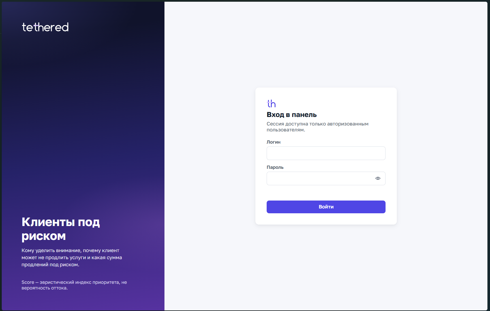
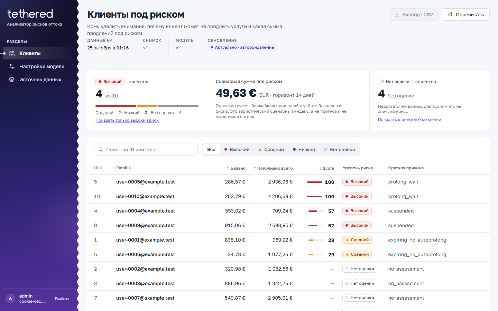
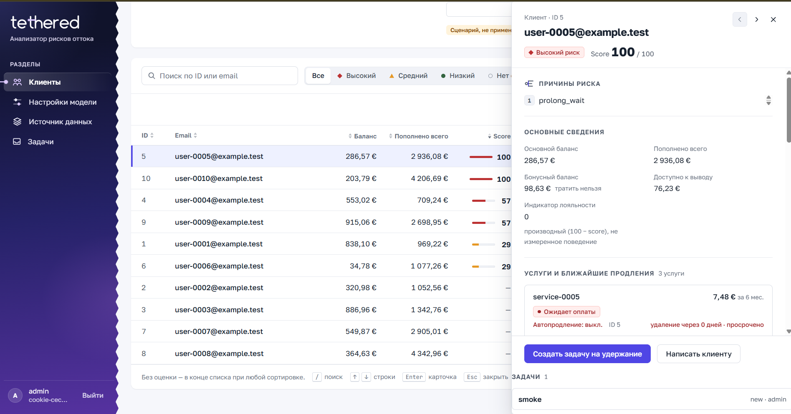
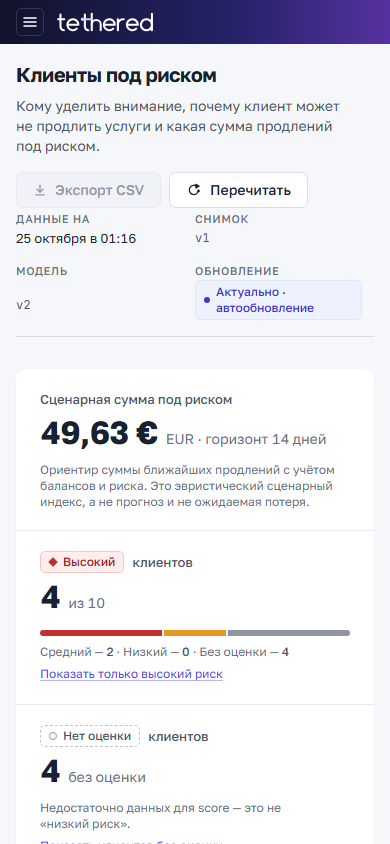
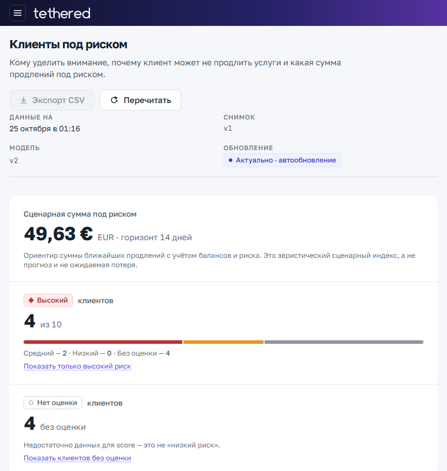

<div align="center">


# Tethered — анализатор рисков оттока

ASP.NET Core 10 · Razor Pages + JSON API · PostgreSQL · Cookie-auth + CSRF · Docker Compose

**Живой стенд:** <https://hack-rnd.cc.cd>

</div>

---

## Что это

Панель для маркетолога: какие клиенты могут не продлить услуги, почему, и какая
сумма ближайших продлений оказывается «под риском» в заданном горизонте.
Один процесс приложения + PostgreSQL, без микросервисов, Redis и внешних очередей.

> **Важно про смысл чисел.** Score — **эвристический индекс приоритета 0–100**,
> а не вероятность оттока и не калиброванный прогноз. «Сценарная сумма под
> риском» — ориентир суммы ближайших продлений с учётом балансов и уровня риска:
> это **эвристический денежный индекс**, а не ожидаемая потеря и не экономия.
> `no_assessment` (недостаток данных) — отдельное состояние, а не «низкий риск».

## Скриншоты живого стенда

| Экран | Снимок |
|---|---|
| Вход |  |
| Список клиентов (desktop 1440) |  |
| Карточка клиента (drawer) |  |
| Сводка (mobile 390) |  |
| Раскладка 760 px |  |

Снимки сняты с реального HTTPS-стенда на синтетических данных `example.test`
(см. раздел про фикстуру). Это не макет.

> Скриншоты сняты с ветки `main` (`5a5d0bd`). В `dev` (`275ba06`) drawer уже
> отличается: задачи под карточкой отбиты боковым отступом, кнопки модалок
> «Создать задачу»/«Написать клиенту» рендерятся (были обрезаны). Мобильные
> снимки 390/760 — со старого UI; переснять после деплоя `dev`.

## Возможности (проверено на стенде)

- Cookie-auth с HttpOnly + SameSite=Strict; CSRF-токен `X-CSRF-TOKEN` для
  всех изменяющих запросов; **общий** fixed-window rate-limit на login
  (`RateLimit:LoginPermit`, default 5/мин, без ключа по пользователю/IP — лимит
  делят все попытки входа, `429` возвращается когда бюджет исчерпан);
  серверный отзыв сессий по security stamp (смена пароля и отключение делают
  старую cookie непригодной на следующем запросе).
- Роли: `admin` (управление пользователями + замена снимка) и `analyst`
  (аналитика и настройки модели); проверки на сервере, не только скрытие кнопок.
- Таблица клиентов: поиск по ID/email, фильтр по уровню риска со счётчиками,
  сортировка по ID/email/балансу/пополнениям/score в обе стороны,
  «без оценки» в конце при любом ключе.
- Карточка клиента: причины риска, вклады факторов, услуги и сроки,
  денежный разбор, транзакции, индикатор лояльности (производный `100 − score`,
  не измеренное поведение).
- Задачи на удержание: создание из карточки, список/поиск/статусы, журнал
  изменений, привязка к `evaluationId`/`asOf` (контекст решения). Статусы:
  new/in_progress/done/cancelled; не выдаёт завершённую задачу за доказанное
  удержание.
- Связь с клиентом: редактор темы/текста с шаблоном по причине риска, черновик,
  копирование, mailto (метка «prepared»), отправка через серверный транспорт —
  явно недоступна (`503 transport_unavailable`) без SMTP/API настроек.
- Сохранённые сегменты: пользовательские пресеты фильтра (q/level/sort/dir)
  в БД, вычисляются на текущем батче — не устаревшая копия клиентов.
- Экспорт CSV: на клиенте из текущего представления таблицы (фильтр/сортировка),
  единицы EUR cents, `no_assessment`, защита от formula injection. Загрузка
  снимка — через UI «Источник данных» (admin) → `PUT /api/v1/source/snapshot`.
- AI-резюме (опционально): `POST /api/v1/ai/brief` — обезличенная сводка
  батча, ручной запуск, кэш по `evaluationId`, маркировка модели/asOf; без
  ключа — `ai_not_configured`, основная аналитика работает.
- Аналитика продлений: `GET /api/v1/analytics/renewals` — ближайшие продления
  по датам с уровнями риска и просрочкой, причины с числом клиентов, переход
  к таблице; одна услуга — одно продление, даты не являются датами оттока.
- `PUT /api/v1/source/snapshot` — атомарная замена снимка + пересчёт.
- `PATCH /api/v1/model/settings` — коэффициенты/пороги с optimistic concurrency
  (`expectedVersion` → `409` при конфликте) и пересчётом. Настройки переживают
  рестарт.
- Фоновый пересчёт по таймеру (`Eval:RefreshSeconds`) публикует новый батч,
  не меняя версий; UI обновляется по смене `evaluationId` без перезагрузки.
- Prometheus `/metrics` и Swagger UI `/api/v1/docs` — **только за auth**.
- Ротация пароля администратора: `POST /api/v1/auth/rotate-password`
  (проверяет текущий, штатный PBKDF2-хеш, без удаления БД).

## Архитектура

```
            ┌─────────────┐   HTTPS    ┌───────────────────────────┐
  клиент →  │ Caddy (TLS) │ ────────▶  │  Churn.Web (ASP.NET Core) │
            └─────────────┘  loopback  │  Razor Pages + JSON API   │
              80/443                   │  cookie-auth, CSRF        │
                                       │  EvaluationService (1 tx) │
                                       └────────────┬──────────────┘
                                                    │ EF Core (Npgsql)
                                            ┌───────▼────────┐
                                            │  PostgreSQL 17 │
                                            │ snapshots,     │
                                            │ model_settings,│
                                            │ eval_runs,     │
                                            │ results        │
                                            └────────────────┘
```

- Оценка — синхронная, публикуется одним батчем в одной транзакции
  (`eval_runs` + `customer_results` + `summary_results`). Неудачный прогон
  ничего не коммитит — последний хороший батч остаётся авторитетным.
- Чтения (`customers`, `customer/{id}`, `summary`, `metrics`) берут только
  последний опубликованный батч — они не запускают пересчёт.
- `asOf` всегда приходит из `TimeProvider` (System/Fake в тестах).

## Модель риска и денежная оценка

Признаки (веса версионируются в `model_settings`):

- `expiring_no_autoprolong` — услуга истекает в горизонте без автопродления;
- `insufficient_funds` — баланса не хватает на ближайшие продления;
- `prolong_wait` — услуга ждёт оплаты;
- `suspended` — услуга приостановлена (не равна отсутствию выручки).

Score = взвешенная сумма вкладов → уровень по порогам `high`/`medium`.
`no_assessment` — когда данных недостаточно для оценки.

Деньги (всегда в **евроцентах**, без float): в горизонте считается стоимость
продлений, доступный покрывающий фонд распределяется один раз на набор продлений
(бонус учитывается только при `bonusState=unlocked`; `withdrawBalance` не
расходуется автоматически). `at_risk` — сценарная сумма под риском с тегом
`semantic="heuristic_money_index"`. Это ограничение подчёркнуто в UI.

## Данные (фикстура)

`data/raw/` — официальная синтетическая фикстура кейса: `data.json` (10 аккаунтов,
30 услуг, 100 транзакций), SQL-схема и сид, генератор `generate.py` и его тест.
Все email — на домене `example.test`; реальных персональных данных нет.
Стенд развёрнут именно с этим снапшотом, а не восстановлением локальной БД.

## Запуск и bootstrap

```bash
cp .env.example .env          # задайте POSTGRES_PASSWORD и ADMIN_PASSWORD
docker compose up -d --build
```

- Миграции применяются при старте.
- Первый admin создаётся только если `Auth:AdminPassword` задан и такого
  пользователя ещё нет — универсального пароля по умолчанию нет.
- Bootstrap снимка — один раз, если задан `BOOTSTRAP_SEED_FILE` и снимка ещё
  нет в БД (на стенде — `./seed/data.json` примонтирован read-only).
- В production перед приложением стоит reverse proxy; `HTTPS_ENABLED=true`
  включает `Secure`-флаг cookie, а `UseForwardedHeaders` доверяет только
  заголовкам от прокси внутри сети compose.

### Переменные окружения (`.env.example`, без значений)

| Ключ | Назначение |
|---|---|
| `POSTGRES_DB` / `POSTGRES_USER` / `POSTGRES_PASSWORD` | доступ к БД внутри сети compose |
| `ADMIN_LOGIN` / `ADMIN_PASSWORD` | первичный admin (создаётся один раз) |
| `BOOTSTRAP_SEED_FILE` | путь в контейнере к снимку-фикстуре (опционально) |
| `HTTPS_ENABLED` | `Secure`-флаг auth-cookie за прокси |
| `EVAL_REFRESH_SECONDS` | интервал фонового пересчёта батча |
| `AI_API_KEY` / `AI_ENDPOINT` / `AI_MODEL` | опциональный AI-brief (без ключа — `ai_not_configured`) |
| `AI_ALLOWED_HOSTS` / `AI_TIMEOUT_SECONDS` / `AI_MAX_RESPONSE_BYTES` | границы AI-вызова |

## API

| Endpoint | Назначение |
|---|---|
| `POST /api/v1/auth/login` / `logout` / `me` / `csrf` | сессия, CSRF-токен |
| `POST /api/v1/auth/rotate-password` | смена пароля (current+new, auth+CSRF) |
| `GET/POST/PATCH /api/v1/admin/users` `PATCH .../{id}/status` | сотрудники и активность (admin) |
| `GET /api/v1/customers` | рейтинг + batch identity |
| `GET /api/v1/customers/{id}` | карточка клиента |
| `GET /api/v1/customers/{id}/tasks` | задачи клиента |
| `GET /api/v1/analytics/summary` | сводка (та же оценочная версия) |
| `GET /api/v1/analytics/renewals` | продления по датам + причины (batch) |
| `GET/POST /api/v1/tasks` `PATCH/{id}` `POST {id}/status` `GET {id}/events` | задачи на удержание |
| `GET/POST /api/v1/messages` `POST {id}/prepared` `POST {id}/send` | сообщения клиенту |
| `GET/POST/PATCH/DELETE /api/v1/segments` | сохранённые сегменты пользователя |
| `POST /api/v1/ai/brief` | AI-резюме батча (опционально) |
| `GET/PATCH /api/v1/model/settings` | коэффициенты + optimistic concurrency |
| `PUT /api/v1/source/snapshot` | атомарная замена снимка |
| `GET /api/v1/ui-config` | интервал polling UI |
| `GET /metrics` | Prometheus (только за auth) |
| `GET /api/v1/docs` | Swagger UI; spec `GET /api/v1/docs/v1.json` |

Документация: `docs/openapi-draft.yaml`, `docs/ARCHITECTURE.md`,
`docs/MODEL-CONTRACT.md`.

## Проверено на стенде

- `dotnet build` — 0 предупреждений; `tests/Churn.Core.Tests` — 69/69
  (baseline 65/105→62, renewal 500→310 EURc, regression на переполнение raw);
  `tests/Churn.IntegrationTests` — **49/49** на реальной PostgreSQL 17
  (Testcontainers) на VPS: валидация входа 400, CSRF, auth, optimistic
  concurrency, what-if scenario_not_applied, отзыв сессий.
- Живой HTTPS: login→customers→detail→PATCH→новый `evaluationId`.
- `/metrics`, `/api/v1/docs`, `v1.json` — `401` анониму, `200` за auth.
- PATCH без CSRF → `403`; с `X-CSRF-TOKEN` → `200`.
- Cookie: `Secure; HttpOnly; SameSite=Strict` при HTTPS.
- `rotate-password` → `204`; старый пароль `401`, новый `204`.
- Задачи: создать `201` с `evaluationId`, статус `200`, журнал событий; stale-клиент → `customerAvailable:false`.
- Сообщение: черновик сохранён; `send` → `503 transport_unavailable` без SMTP.
- Сегмент: `201`, принадлежит пользователю.
- AI brief: при отключённом ключе `404 ai_not_configured`; с ключом — реальный ответ с `evaluationId`/`asOf`.
- Прямой порт приложения недоступен извне — только loopback/сеть compose.

## Ограничения

- Score — индекс, не вероятность; истории смены статусов в данных нет,
  поэтому accuracy/AUC не заявляются.
- Отзыв сессий — через security stamp: после смены пароля или отключения
  пользователя ранее выданная cookie отклоняется на следующем запросе. Отзыв
  происходит при обращении к защищённому ресурсу, а не по push-таймеру.
- Интеграционные тесты (`tests/Churn.IntegrationTests`, Testcontainers + PG 17)
  требуют Docker — прогнаны на VPS: **49/49**.
- OIDC — не реализован (отложен как опциональный бонус по ТЗ).
- Prometheus+Grafana — опциональный профиль `compose.observability.yaml`
  (loopback listeners, scrape-token); по умолчанию не поднимается.
